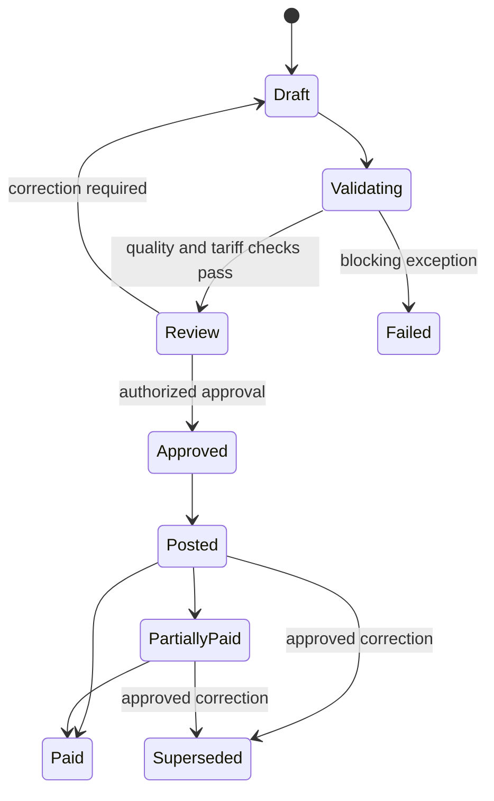
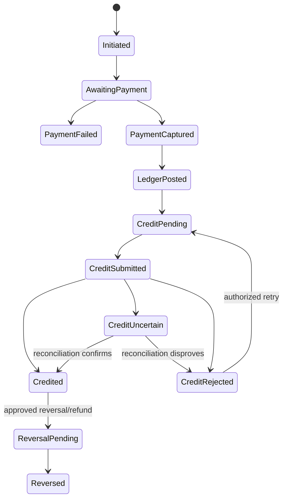

# Billing, Payments and Reconciliation

## 1. Purpose

This document defines the target financial and energy lifecycles for MSM. It
does not adopt the current prototype's automatic-credit behavior.

## 2. Separate facts

The following must never be collapsed into one status:

| Fact | Authority |
|---|---|
| Customer requested a purchase | MSM |
| Gateway accepted an attempt | Payment gateway |
| Money was captured | Payment gateway, later settlement/bank evidence |
| MSM ledger recorded the money | MSM |
| Provider credit was requested | MSM integration record |
| SteamaCo accepted a transaction | SteamaCo |
| Meter/device applied the effect | SteamaCo/device outcome |
| Customer was notified | Notification provider/MSM |

## 3. Consumption calculation

### 3.1 Cumulative registers

For a normal interval:

`consumption = end register - start register`

MSM shall not sum cumulative register values.

### 3.2 Provider interval usage

SteamaCo currently supplies both cumulative `reading` and `usage_amount`.
During ingestion MSM shall:

1. store both values;
2. calculate the register delta;
3. compare it with `usage_amount`;
4. record tolerance and result;
5. use the certified derivation policy for billing.

The current sample showed exact agreement across 186 comparable intervals, but
this does not remove the need for ongoing validation.

### 3.3 Resets and replacements

A negative delta is not negative consumption by default. It may indicate reset,
rollover, replacement, correction or bad data.

MSM shall require:

- a known reset/installation event; or
- an approved correction/estimate;

before the interval can become billable.

### 3.4 Gaps and estimates

Gap policy must define:

- maximum acceptable interval;
- interpolation eligibility;
- estimation method;
- approval threshold;
- customer disclosure;
- later true-up.

Estimated consumption must remain distinguishable from measured consumption.

## 4. Tariff calculation

### 4.1 Effective version

Each usage interval is split at:

- tariff-version boundaries;
- time-of-use boundaries;
- billing-period boundaries;
- meter assignment boundaries;
- relevant tax-policy boundaries.

Every calculated line retains the tariff version and source intervals.

### 4.2 Calculation order

Unless an approved tariff states otherwise:

1. validate/split usage intervals;
2. apply time-of-use and tier allocation;
3. calculate energy components;
4. calculate approved fixed components;
5. apply discounts/credits;
6. calculate taxes using configured basis;
7. round at the configured component or bill level;
8. validate totals and post.

### 4.3 Rounding

The tariff version must define:

- quantity scale;
- rate scale;
- line-amount scale;
- midpoint rule;
- whether rounding occurs per interval, tier, line or total.

Floating-point arithmetic is prohibited for billable quantities and money.

## 5. Postpaid lifecycle

Rules:

- draft calculations have no ledger effect;
- approval and posting are separate auditable events;
- posting creates receivable/revenue/tax journals;
- payment allocation reduces receivable;
- correction uses an adjustment or superseding bill.

## 6. Prepaid purchase lifecycle

Rules:

- an initiated purchase cannot credit a customer;
- a client response cannot prove payment capture;
- payment-captured and credit-pending is a valid, visible state;
- timeout is uncertain, not failed;
- retries reuse the same economic reference;
- later callbacks cannot silently downgrade a successful credited purchase;
- refunds and provider reversals require linked workflows.

## 7. Payment processing

### 7.1 Intent creation

MSM creates:

- immutable purchase reference;
- expected amount/currency;
- service account;
- expiry;
- payment channel;
- return/callback correlation.

### 7.2 Callback intake

Callback processing shall:

1. authenticate the sender/signature;
2. enforce timestamp tolerance where supported;
3. reject exact replay;
4. store a checksum and sanitized envelope;
5. return promptly;
6. verify status server-to-server;
7. apply a transactional state transition.

### 7.3 Verification

Before capture:

- gateway reference must match;
- amount and currency must match;
- merchant/account scope must match;
- status must represent final capture;
- the event must not already have an economic effect.

### 7.4 Ledger posting

A captured prepaid payment normally debits settlement/cash-in-transit and
credits customer prepaid liability. The exact chart of accounts requires
finance approval.

Provider credit does not create a second cash receipt.

## 8. SteamaCo credit submission

The live provider schema supports a `PAY` transaction category, but its
economic and idempotency semantics remain unconfirmed.

Before enabling:

1. obtain a sandbox;
2. agree amount/unit/sign semantics;
3. agree a stable reference/idempotency contract;
4. test duplicate submission;
5. test timeout after provider commit;
6. test validation rejection;
7. test reversal and STS behavior;
8. confirm reconciliation lookup.

The current backend request using `payment_method` and `description` must not be
used as the production contract.

## 9. Idempotency

### 9.1 Internal

Unique economic keys:

- one active purchase order per public purchase reference;
- one accepted gateway capture per gateway transaction;
- one ledger journal per captured-payment effect;
- at most one successful provider credit per payment and target service
  account;
- one processed callback per provider event/checksum.

### 9.2 External

MSM shall send a stable reference using the vendor-confirmed mechanism. A
generated technical retry ID must not replace the economic reference.

If the provider cannot guarantee idempotency, automatic retry after an
ambiguous timeout is prohibited. The item moves to reconciliation.

## 10. Refunds and reversals

Possible sequences include:

1. captured money, no provider credit: refund money;
2. captured money and provider credit: reverse credit, then refund or record
   approved receivable;
3. provider credit with disputed capture: freeze and escalate;
4. partial refund: allocate and reverse proportionally only when supported.

Every sequence requires:

- original references;
- reason;
- approval;
- gateway/provider outcomes;
- reversing ledger entries;
- customer communication.

## 11. Reconciliation

### 11.1 Daily finance reconciliation

Compare:

- gateway captures, failures and refunds;
- settlement/bank evidence;
- MSM payment and ledger records;
- SteamaCo `PAY`/reversal records.

### 11.2 Billing reconciliation

Compare:

- validated usage;
- bill lines;
- ledger revenue/receivable postings;
- adjustments and superseded bills.

### 11.3 Energy reconciliation

For aligned intervals:

`source inflow - downstream consumption - known internal load = residual`

The residual requires classification; it is not automatically a technical
loss, theft or customer charge.

### 11.4 Exception states

Exceptions move through open, assigned, investigating, awaiting external
action, resolved and closed.

Resolution must record evidence and, when financial, approval. “Reconciled”
must never mean merely changing a status without proving the underlying match.

## 12. Period close

A period may close only when:

- ingestion watermarks cover the period;
- mandatory quality exceptions are resolved or approved;
- tariff versions are complete;
- billing totals balance to ledger postings;
- payment and provider-credit exceptions are quantified;
- source reconciliation scope is disclosed;
- reports and checksums are retained.

Late readings or corrections after close create an adjustment in a later open
period or an approved superseding run.

## 13. Required tests

At minimum:

- duplicate callbacks;
- out-of-order callback success/failure;
- gateway timeout before and after capture;
- provider timeout before and after credit;
- rejected, duplicated and reversed provider transactions;
- tariff boundary inside a reading interval;
- register reset/replacement;
- missing and late readings;
- bill rerun reproducibility;
- partial/full refund;
- period close with unresolved exceptions;
- concurrent retries against the same purchase.
