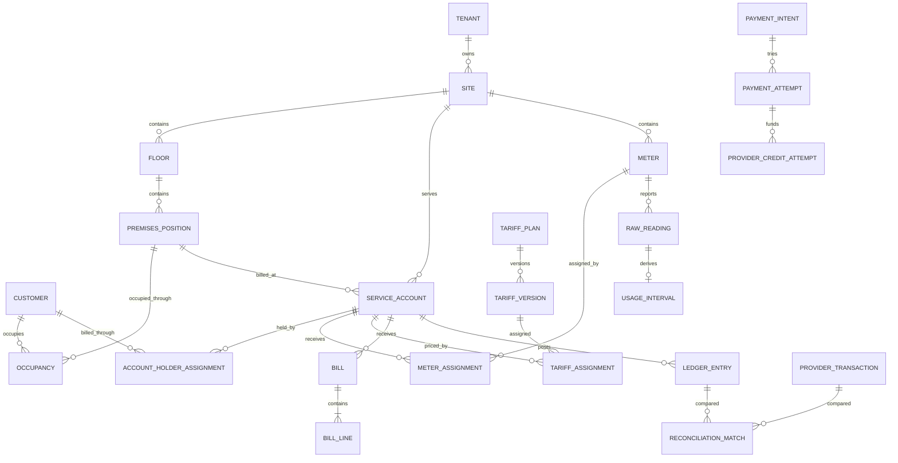

# MicroAccess Smart Metering Domain Model

## 1. Status and purpose

This document defines the target logical records and invariants for MSM. Names
are technology-neutral. Physical table names and service boundaries may differ,
but an implementation must preserve the stated ownership and history.

## 2. Bounded contexts

| Context | Responsibility |
|---|---|
| Identity and Access | Human and service identities, roles, scopes and sessions |
| Organisation | Tenants, sites, utilities and provider mappings |
| Customer Accounts | Customers, service accounts, contacts and consent |
| Meter Operations | Meters, topology, installation and assignments |
| Meter Data | Raw readings, normalized usage, quality and corrections |
| Tariffs | Plans, versions, components and assignments |
| Billing | Periods, runs, bills, lines, adjustments and statements |
| Payments | Intents, attempts, callbacks, refunds and provider credit |
| Ledger | Immutable financial postings and balances |
| Reconciliation | Comparisons, exceptions, ownership and resolution |
| Operations | Alerts, incidents, directives and device outcomes |
| Communications | Templates, notifications and delivery attempts |
| Audit and Integration | Provider snapshots, cursors, outbox and audit events |

## 3. Core relationship view

## 4. Identity and organisation

### 4.1 Tenant

Represents a legal or operational MSM customer organisation.

Required attributes:

- internal ID;
- legal and display names;
- default currency and timezone;
- lifecycle state;
- retention and billing-policy references.

Invariant: provider company/account IDs are mappings, not the tenant primary
key.

### 4.2 Site

Represents a physical property or managed electricity boundary.

Required attributes:

- tenant;
- name and location;
- timezone;
- lifecycle state;
- SteamaCo site mapping;
- commissioning and decommissioning dates.

### 4.3 Utility

Represents electricity or another measured utility.

Required attributes:

- unit definitions;
- precision;
- register behavior;
- provider utility mapping.

The first release supports electricity but does not hard-code electricity into
all storage structures.

### 4.4 Actor, Role and RoleAssignment

An actor is either a human or service identity. A role assignment binds a role
to a tenant/site scope and effective interval.

Invariants:

- service credentials are never used as human identities;
- customers and staff use different role classes;
- permission checks use internal scope, not an upstream user flag.

## 5. Customer accounts

### 5.1 Customer

Represents a person or organisation receiving service.

Owns:

- internal identity;
- type;
- status;
- contact and consent references;
- provider customer mappings.

Personal information should be separated from operational data where practical.

### 5.2 ServiceAccount

Represents the billable relationship at a permanent premises position. The
account remains anchored to the position when a tenant changes, while the
account holder changes through an effective-dated assignment.

Required attributes:

- account number;
- site;
- premises position;
- billing mode: prepaid or postpaid;
- currency;
- start/end dates;
- status;
- credit policy;
- provider customer mapping.

One customer may hold multiple service accounts. A service account may survive
a meter replacement or tenant change.

### 5.3 Floor and PremisesPosition

`Floor` represents a permanent building level such as Ground Floor or Fifth
Floor. `PremisesPosition` represents a permanent metered shop, office or common
area on that floor, with a stable code such as `G01` or `5F-01`.

Required attributes:

- site and floor;
- stable position code and display label;
- position type: tenant unit, common area, plant room or source location;
- lifecycle state;
- provider customer mapping, when the upstream customer record is used to
  represent the position.

Invariants:

- the position identity does not change when its tenant or trading name changes;
- a provider `first_name` used as the floor/position label is an import mapping,
  not the internal primary key;
- a provider `last_name` used as the current tenant name is not historical
  occupancy evidence by itself;
- renaming a position never rewrites historical readings, bills or occupancy.

### 5.4 Occupancy and AccountHolderAssignment

`Occupancy` records which customer or tenant occupies a premises position for
an effective interval. `AccountHolderAssignment` records which customer is
financially responsible for a service account for an effective interval.

These intervals may normally align, but are separate so that a landlord,
management company or incoming tenant can be billed under an approved policy.
Overlapping active assignments require an explicit multi-party billing rule.

### 5.5 CustomerAccessGrant

Maps an MSM customer login to a service account with an effective interval and
granting actor.

This record, not provider customer identity alone, controls customer visibility.

## 6. Meter operations

### 6.1 Meter

Represents a physical device.

Required attributes:

- serial/reference and asset identity;
- manufacturer, OEM, model and version;
- meter type and phase;
- utility;
- current lifecycle state;
- provider meter mapping;
- commissioned/retired timestamps.

### 6.2 MeterInstallation

Records a physical installation epoch:

- meter;
- site and location;
- seal;
- installer;
- installation/removal time;
- opening/closing register;
- evidence;
- commissioning result.

### 6.3 MeterAssignment

Effective-dated relationship between a meter and service account.

Invariants:

- no overlapping current billable assignment for one meter;
- no overlapping primary meter assignment for one service account unless an
  approved multi-meter policy applies;
- reassignment never changes historical intervals;
- every change records reason and actor.

### 6.4 MeterTopologyLink

Represents physical relationships independently from billing:

- parent meter;
- feeder;
- source classification;
- downstream meter;
- effective interval.

Source classifications include grid, solar, generator, distribution/bulk and
customer load.

## 7. Meter data

### 7.1 ProviderPayload

Immutable metadata for an upstream response:

- provider;
- endpoint and request correlation;
- retrieval time;
- upstream release;
- checksum;
- encrypted or access-controlled raw payload location;
- parsing status.

### 7.2 RawReading

Canonical immutable representation of an upstream reading.

Required attributes:

- provider mapping and upstream identity/checksum;
- meter and utility;
- metric;
- provider timestamp and received timestamp;
- raw numeric value;
- unit;
- provider anomaly flag;
- source payload.

Uniqueness is defined by provider identity when available, otherwise by a
stable content key such as provider, meter, metric, timestamp and value.

### 7.3 UsageInterval

Derived consumption for a start/end interval.

Required attributes:

- meter;
- utility;
- start and end readings;
- start/end timestamps;
- calculated quantity;
- provider-reported quantity, when available;
- derivation method and version;
- quality state;
- correction/supersession link.

### 7.4 DataQualityEvent

Records duplicate, gap, reset, decrease, spike, anomaly, unit mismatch,
timezone issue, late arrival or manual review.

An event has severity, disposition, evidence and resolution. It does not mutate
the original reading.

### 7.5 IngestionCursor

Tracks a resumable provider stream or report:

- endpoint/report type;
- site/meter scope;
- last successful watermark;
- request parameters;
- provider release;
- status and retry metadata.

## 8. Tariffs

### 8.1 TariffPlan

Stable business identity such as “Commercial Prepaid Standard”.

### 8.2 TariffVersion

Immutable published version with:

- effective interval;
- currency;
- utility and unit;
- billing mode;
- rounding and tax policies;
- publication approval;
- provider-setting snapshot.

### 8.3 TariffComponent

Typed calculation component:

- flat energy rate;
- tier;
- time of use;
- subscription;
- connection fee;
- tax;
- discount;
- demand or power factor charge;
- approved adjustment rule.

### 8.4 TariffAssignment

Effective-dated assignment to a service account or approved group.

Invariant: every billable usage interval resolves to exactly one applicable
tariff rule set or becomes an exception.

## 9. Billing

### 9.1 BillingPeriod

Defines site, timezone, start/end instants and open/closed state.

### 9.2 BillingRun

Versioned execution for a period with:

- input snapshot/checksum;
- calculation version;
- status;
- coverage/quality summary;
- initiating and approving actors;
- superseded run link.

### 9.3 Bill

Customer obligation generated from an approved run.

Required attributes:

- bill number;
- service account;
- period;
- issue/due dates;
- currency;
- subtotal, tax, adjustments and total;
- status;
- source run and version.

### 9.4 BillLine

Each line references:

- tariff component/version;
- quantity and unit;
- rate;
- amount and rounding;
- source usage intervals or fixed-charge reason.

### 9.5 BillingAdjustment

Explicit debit or credit with reason, evidence, approval, affected bill and
ledger postings.

Posted bill lines are never edited in place.

## 10. Payments and provider credit

### 10.1 PurchaseOrder

Customer intent to buy prepaid value. Contains requested money amount,
service account, currency, channel and stable public reference.

### 10.2 PaymentIntent

Request made to a payment gateway. Contains gateway reference, expected amount,
expiry and state.

### 10.3 PaymentAttempt

Each gateway attempt, callback and verification result. A captured result is
immutable and may be linked to a later refund/reversal.

### 10.4 ProviderCreditAttempt

Separate attempt to create SteamaCo credit:

- stable MSM idempotency/reference key;
- payment;
- target provider customer;
- requested category and amount;
- request/response checksum;
- provider reference;
- state, retry and failure reason.

Invariant: one captured payment can produce at most one successful economic
credit, even if multiple technical attempts occur.

### 10.5 Refund and Reversal

Refund represents money returned through the gateway. Provider reversal
represents upstream credit removed. They are related but distinct operations.

Neither overwrites the original payment or credit record.

## 11. Financial ledger

### 11.1 LedgerAccount

Accounts include cash/settlement, customer receivable, customer prepaid
liability, revenue, tax, refund payable and reconciliation suspense.

### 11.2 Journal and LedgerEntry

A journal is one balanced business posting. Entries contain debit/credit,
currency, amount, account, service account, source record and immutable
correlation.

Invariants:

- every journal balances by currency;
- entries are append-only;
- displayed balances derive from entries or a verified projection;
- corrections use reversing and replacement journals.

### 11.3 ProviderTransaction

Mirrored SteamaCo transaction stored separately with upstream category,
reference, amount, balance and raw provenance.

Provider balance is an external fact to reconcile, not the MSM ledger itself.

## 12. Reconciliation

### 12.1 ReconciliationRun

Defines type, period, scope, source watermarks, status and totals.

Types include:

- payment gateway to bank/settlement;
- payment gateway to MSM ledger;
- captured payment to provider credit;
- MSM ledger to provider transaction;
- source energy to downstream usage.

### 12.2 ReconciliationMatch

Links records considered equivalent with matching method and confidence.

### 12.3 ReconciliationException

Contains:

- category and severity;
- related records;
- financial/energy amount;
- owner and due date;
- state;
- evidence;
- resolution and approval.

Closing an exception does not mutate source records.

## 13. Operations and communication

### 13.1 ProviderAlert and Incident

Provider alerts are mirrored. MSM incidents provide ownership, workflow,
comments, evidence and resolution.

### 13.2 DirectiveRequest and ProviderDirective

DirectiveRequest is the authorized MSM intent. ProviderDirective is the
upstream submission and device outcome.

Required states include requested, awaiting approval, submitted, accepted,
device-confirmed, rejected, timed out, cancelled and reconciled.

### 13.3 Notification and DeliveryAttempt

Notification is the intended message linked to a domain record. DeliveryAttempt
records channel/provider attempts and outcomes.

## 14. Audit and integration

### 14.1 AuditEvent

Append-only record with actor, action, target, reason, before/after checksum,
time, network/session context and correlation ID.

### 14.2 OutboxEvent

Durable event written in the same transaction as the source change. Workers
publish or act on it idempotently.

### 14.3 IntegrationAttempt

Records endpoint, operation, correlation, timing, sanitized result, retry and
error class. It must not store secrets or unrestricted personal/raw payment
data.

## 15. Global invariants

1. Monetary values use decimal types and explicit currency.
2. Energy values use decimal types and explicit units.
3. Business timestamps are stored as instants plus the applicable timezone
   context.
4. Provider IDs never replace MSM primary keys.
5. Effective intervals do not overlap where uniqueness is required.
6. Source records are immutable; corrections are versioned.
7. Financial balances derive from immutable ledger entries.
8. A bill references the exact tariff and usage versions used.
9. Captured payment and applied provider credit remain separately observable.
10. Destructive meter commands require authorization and confirmed outcomes.
