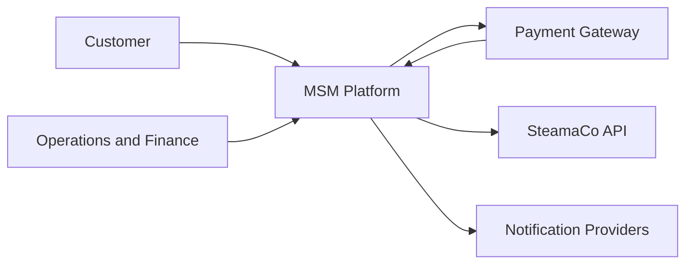
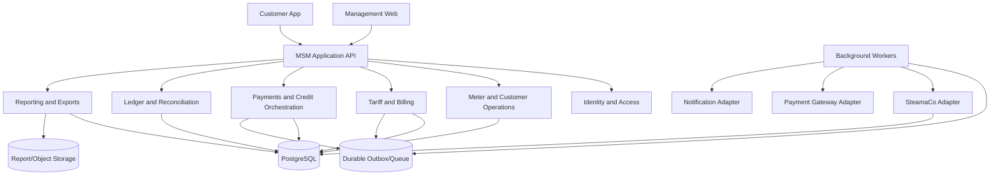

# MicroAccess Smart Metering Target Architecture

## 1. Status

This document defines the logical target architecture. It deliberately does not
declare every technology choice final. Technology decisions require separate
architecture decision records and proof against the approved requirements.

The current Fastify backend is a prototype input, not proof that the target
architecture has been delivered.

## 2. System context

No browser or mobile application may call SteamaCo or a payment provider with
MSM-owned service credentials.

## 3. Logical architecture

The boxes are logical responsibilities. The first deployment may use a modular
monolith with separately runnable workers. Service separation is justified only
when ownership, scale or isolation requires it.

## 4. Application modules

### 4.1 Identity and Access

Responsibilities:

- staff and customer authentication;
- tenant/site-scoped authorization;
- service identities;
- session and credential security;
- step-up and approval for high-risk actions.

It does not delegate MSM customer access to SteamaCo `/users/`.

### 4.2 Organisation and Mapping

Responsibilities:

- tenants, sites and utilities;
- provider account/site/customer/meter mappings;
- effective-dated assignments;
- source and feeder topology.

### 4.3 Meter Data

Responsibilities:

- raw provider snapshots;
- idempotent ingestion;
- normalized readings and usage intervals;
- units/timezones;
- quality events and corrections;
- freshness and coverage projections.

### 4.4 Tariff and Billing

Responsibilities:

- tariff plan/version approval;
- tariff assignment;
- deterministic billing calculation;
- bill review, posting and supersession;
- statements and bill exports.

### 4.5 Payments and Credit

Responsibilities:

- purchase/payment intents;
- gateway callbacks and verification;
- provider credit orchestration;
- refund/reversal workflows;
- receipts and customer-visible state.

### 4.6 Ledger and Reconciliation

Responsibilities:

- immutable double-entry journal;
- payment/provider transaction mirrors;
- daily/period reconciliation;
- exception ownership and resolution.

### 4.7 Operations

Responsibilities:

- meter health;
- provider alerts and DLMS events;
- incidents;
- controlled directives;
- commissioning/readiness work.

### 4.8 Reporting and Communications

Responsibilities:

- governed dashboards and exports;
- report generation and retention;
- notification templates and delivery;
- customer documents.

## 5. SteamaCo integration

### 5.1 Adapter boundary

All provider interaction passes through a typed SteamaCo adapter. Internal
modules consume MSM domain types, not raw provider response shapes.

The adapter shall provide:

- authentication;
- account-scope check;
- pagination;
- throttling;
- timeout and bounded retry;
- response/schema validation;
- redacted structured logging;
- provider correlation;
- raw payload provenance;
- mapping into versioned MSM records.

### 5.2 Versioned clients

The client contract is tied to the verified upstream release. A field change
must fail visibly rather than silently producing incomplete billing data.

Contract tests cover:

- root resources;
- core field types;
- enum values;
- pagination;
- supported filters;
- nested link discovery;
- error classes.

### 5.3 Synchronization modes

| Data | Mode |
|---|---|
| Account, sites, utilities | Scheduled and startup validation |
| Customers and meters | Scheduled incremental mirror plus manual refresh |
| Readings | Frequent resumable ingestion |
| Provider transactions | Incremental ingestion plus reconciliation backfill |
| Alerts and DLMS events | Frequent polling until webhooks are certified |
| Reports | On-demand governed jobs |
| Directives | Submission worker only after safety gate |

Reading endpoints currently lack verified date filters. The initial worker must
deduplicate the observed recent window and use AMI reports for governed
historical backfill until SteamaCo provides a stable cursor/filter.

### 5.4 Raw and normalized storage

Provider payloads are retained with access restrictions and checksum. Parsed
records are stored separately. A parser change creates a new derivation version
instead of mutating raw evidence.

## 6. Payment integration

Payment adapters must:

- create provider intents server-side;
- validate callbacks and webhook signatures;
- verify final status directly;
- normalize provider states;
- support lookup by stable reference;
- retain sanitized evidence;
- expose refund/settlement records.

Payment state changes and ledger/outbox writes occur in one database
transaction. External calls occur from workers, not inside an uncommitted
financial database transaction.

## 7. Data stores

### 7.1 PostgreSQL

Authoritative for:

- application identities and permissions;
- mappings and assignments;
- normalized meter and billing records;
- financial ledger;
- reconciliation;
- audit and outbox.

Financial and lifecycle transitions use transactions, unique constraints and
explicit optimistic/pessimistic locking where appropriate.

### 7.2 Object/report storage

Stores:

- generated bills/statements;
- provider report artifacts;
- large raw payload archives;
- evidence attachments;
- export manifests and checksums.

Local filesystem storage is acceptable only with backup, retention and
multi-process access guarantees. The logical interface must permit later
replacement.

### 7.3 Queue/outbox

A durable outbox prevents a committed database change from losing its required
side effect.

Workers claim jobs with leases, stable idempotency keys, attempt counters,
scheduled retry and terminal/manual-review states.

Redis may be used for ephemeral caching or rate limiting, but never as the only
record of payment, credit, bill or reconciliation state.

## 8. API design

### 8.1 External MSM API

The API uses:

- versioned resource paths;
- authenticated tenant/site context;
- stable public IDs;
- idempotency keys for supported mutations;
- correlation IDs;
- consistent error bodies;
- cursor/page contracts;
- explicit freshness/quality metadata.

### 8.2 Command/query separation

High-risk operations use command resources rather than misleading synchronous
verbs. For example, a remote disconnect creates a DirectiveRequest. HTTP
acceptance does not mean the device disconnected.

### 8.3 Customer data boundary

Customer endpoints resolve access through current and historical
CustomerAccessGrant and MeterAssignment records. A client-supplied customer or
meter ID is never sufficient authorization.

## 9. Security architecture

### 9.1 Secrets

- Store outside Git and container images.
- Use different credentials per environment.
- Rotate and revoke.
- Prevent command-line, process-list and log disclosure.
- Never return upstream tokens to clients.

### 9.2 Authorization

Separate permissions include:

- view operations;
- manage assignments;
- manage tariffs;
- run/approve billing;
- record/approve adjustments;
- reconcile finance;
- initiate/approve refunds;
- request/approve unsafe commands;
- administer integration.

### 9.3 Data protection

- TLS for all external and internal sensitive traffic.
- Database and backup encryption.
- Field-level protection/access controls for high-risk personal and payment
  evidence.
- Redaction at logging boundaries.
- Retention and deletion policy by record class and legal need.

### 9.4 Financial and command safeguards

- Signature and replay protection for callbacks.
- Stable idempotency and unique economic constraints.
- Maker-checker approval for configured thresholds.
- No automatic success on timeout.
- Append-only audit.

## 10. Observability

Every integration and worker emits:

- correlation ID;
- operation and scope;
- attempt count;
- duration;
- outcome/error class;
- provider status code;
- retry/manual-review decision;
- data watermark/freshness;
- no secrets or unrestricted personal data.

Required operational indicators:

- ingestion lag and coverage;
- schema/validation failures;
- provider availability and throttling;
- pending/uncertain credits;
- unreconciled money;
- billing exceptions;
- failed outbox jobs;
- alert and incident age;
- backup and restore status.

Metrics do not replace event/audit records.

## 11. Failure behavior

| Failure | Required behavior |
|---|---|
| SteamaCo unavailable | Continue local reads; queue governed retries; show freshness |
| Unknown SteamaCo schema | Quarantine payload; alert; do not produce billable data |
| Payment callback repeated | Return idempotent result; no second ledger effect |
| Payment captured, provider unavailable | Preserve captured and credit-pending state |
| Provider credit timeout | Mark uncertain; reconcile before unsafe retry |
| Reading gap/anomaly | Block or estimate according to approved policy |
| Report generation uncertain | Poll/reconcile; do not label complete |
| Directive timeout | Show unknown/pending; do not claim device outcome |
| Database/outbox partial failure | Transaction rollback or durable replay |

## 12. Deployment

The initial on-premise deployment should have:

- reverse proxy and TLS termination;
- application API process;
- separately supervised workers;
- PostgreSQL;
- protected object/report storage;
- optional Redis for ephemeral functions;
- encrypted off-host backups;
- monitoring and centralized logs;
- outbound allow-listing for SteamaCo, payment and notification providers.

Database, cache and administration ports must not be publicly exposed.
Development dashboards must not be enabled unauthenticated in production.

Cloudflare Tunnel or another ingress mechanism is a deployment choice, not the
security boundary. Application authentication, authorization and origin
hardening remain mandatory.

## 13. Recovery objectives

Recovery point and recovery time objectives require business approval.
Regardless of target:

- financial and billing records need transactional backup consistency;
- restore tests must prove ledger balance and outbox continuity;
- provider sync can replay from durable watermarks/reports;
- a restored system must not duplicate external financial effects.

## 14. Technology decisions still required

Architecture decision records are required for:

- web and mobile frameworks;
- identity provider;
- queue/worker implementation;
- object storage;
- payment gateway;
- notification providers;
- deployment/orchestration;
- observability stack;
- backup and disaster recovery tooling.

Selections must follow product, security and operating requirements rather than
preserving a previously named stack by default.
